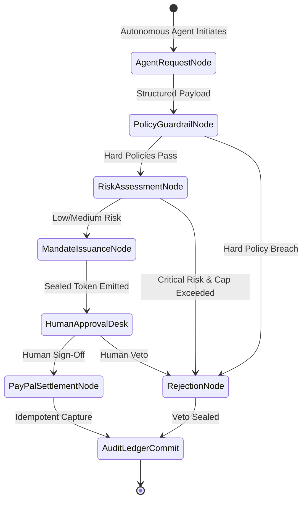
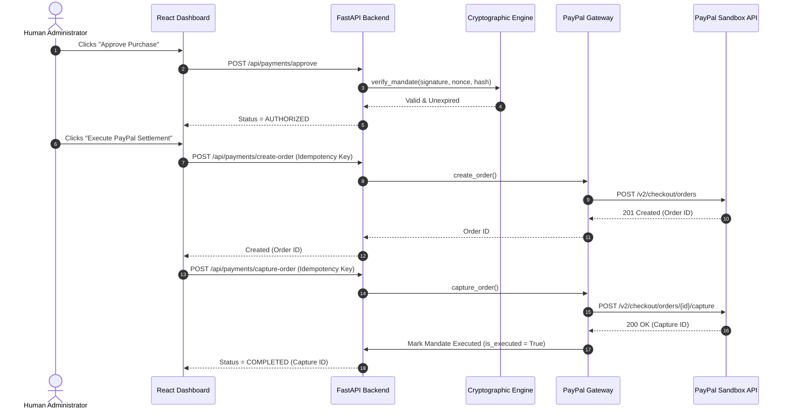
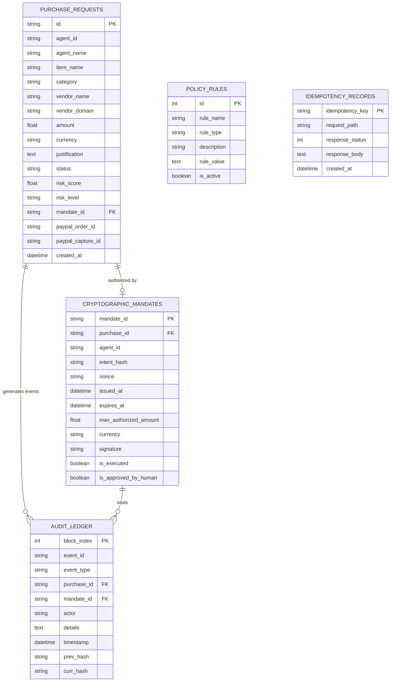

# TRUSTPAY AI — Application Architecture Document

**Version:** 1.0.0 (Phase 1 Baseline)  
**System Vision:** Secure Financial Control & Cryptographic Authorization Layer for Autonomous AI Agents

---

## 1. System Overview

TRUSTPAY AI introduces a zero-trust financial intermediary layer between autonomous artificial intelligence agents and real-world capital settlement rails (specifically PayPal Sandbox Orders v2). The fundamental premise of the architecture is that **no Large Language Model (LLM) or autonomous software agent is ever granted direct execution rights over payment APIs**.

Instead, agent procurement operates strictly through a structured proposal and verification state machine orchestrated with LangGraph, validated deterministically with Pydantic, scored for operational and fraud risk, sealed with an HMAC-SHA256 cryptographic mandate, approved by an authorized human buyer, and settled through idempotent payment gateways.

---

## 2. Component Responsibilities

```
+---------------------------------------------------------------------------------+
|                                 TRUSTPAY AI                                     |
+---------------------------------------------------------------------------------+
|  Autonomous Procurement Agent (Google Gemini / Heuristic Parser)                |
|  - Translates agent task context into structured procurement specs              |
+---------------------------------------------------------------------------------+
|  Policy Guardrail Agent (Deterministic Rule Engine)                             |
|  - Enforces Single Caps, 24h Velocity, Whitelists, Blacklists, Banned Categories|
+---------------------------------------------------------------------------------+
|  Risk Analysis Engine (Multi-Factor Scoring 0-100)                              |
|  - Anomaly detection, duplicate/replay checks, domain reputational scoring      |
+---------------------------------------------------------------------------------+
|  Cryptographic Mandate Engine (HMAC-SHA256 & Nonce Management)                  |
|  - Issues tamper-proof digital authorization tokens with integer epoch expiry   |
+---------------------------------------------------------------------------------+
|  Human-in-the-Loop Review Desk (Admin Approval Gate)                           |
|  - Mandatory digital human sign-off before payment execution                    |
+---------------------------------------------------------------------------------+
|  PayPal Orders v2 Gateway (Settlement Layer)                                   |
|  - Idempotent OAuth2 order creation and capture via api-m.sandbox.paypal.com    |
+---------------------------------------------------------------------------------+
|  Tamper-Evident Audit Ledger (SHA-256 Hash Chaining)                            |
|  - Append-only cryptographically linked block chain with integrity verifier     |
+---------------------------------------------------------------------------------+
```

### Module Breakdown:
1. **`backend/agents/procurement_agent.py`**:
   - Parses natural language requests (e.g. "Order 5 GitHub Copilot seats") into validated Pydantic models.
   - Leverages Google Gemini models when configured, falling back seamlessly to rule-based pattern matching.
2. **`backend/agents/policy_agent.py`**:
   - Executes hard deterministic guardrails prior to risk scoring.
   - Enforces $1,000 single transaction ceiling, $5,000 rolling 24h velocity cap, domain whitelists/blacklists, and zero-tolerance prohibited categories (e.g., gambling, crypto, gift cards).
3. **`backend/agents/risk_agent.py`**:
   - Scores requests between 0.0 and 100.0 based on ticket size, merchant domain risk, burst frequency, and justification depth.
   - Categorizes risk levels into LOW (<30), MEDIUM (30–69), and HIGH (>=70).
4. **`backend/security/crypto_engine.py`**:
   - Constructs a canonical SHA-256 digest of `{agent_id, amount, currency, item_name, vendor_domain, vendor_name}`.
   - Signs the intent with an HMAC-SHA256 signature using the server's master secret and a unique 128-bit cryptographic nonce.
   - Provides constant-time signature verification (`hmac.compare_digest`) and an interactive Tamper Lab for adversary simulation.
5. **`backend/paypal/` & `backend/services/paypal_service.py`**:
   - Connects to PayPal Sandbox v2 endpoints (`/v1/oauth2/token`, `/v2/checkout/orders`).
   - Requires valid signed mandate and human approval before issuing any API call.
   - Enforces `PayPal-Request-Id` idempotency headers.
6. **`backend/services/audit_service.py`**:
   - Appends all system events into an immutable SHA-256 hash-chained block sequence.
   - Supports live block-by-block cryptographic verification.

---

## 3. Agent Communication & Workflow (LangGraph)

The lifecycle of every purchase request is coordinated through a compiled LangGraph state machine:



1. **Agent Intent**: The autonomous agent sends an unstructured or structured purchase intent.
2. **Policy Evaluation**: The Policy Guardrail Agent inspects single caps, daily velocity, whitelists, and banned categories. If any hard check fails, the state transitions immediately to `REJECTED`.
3. **Risk Scoring**: The Risk Analysis Engine computes risk metrics and flags anomalies.
4. **Cryptographic Sealing**: If eligible, the Cryptographic Mandate Engine generates a nonce, sets an expiration window, and signs the payload with HMAC-SHA256.
5. **Human Sign-Off**: The transaction is placed in `PENDING_HUMAN_APPROVAL`. A human buyer inspects the risk score and digital proof.
6. **Payment Settlement**: Upon approval, the PayPal Gateway creates and captures the order idempotently.
7. **Audit Append**: An immutable audit block is generated and linked to the previous block's hash.

---

## 4. Payment Execution Flow



---

## 5. Security Boundaries

| Boundary | Threat Model Addressed | Enforcement Mechanism |
| :--- | :--- | :--- |
| **Agent $\to$ Control Layer** | Prompt injection, runaway retry loops, unauthorized spending | Pydantic strict schemas, rate limiting, deterministic caps, banned category filters. |
| **Control Layer $\to$ Gateway** | In-transit tampering, parameter inflation, merchant spoofing | HMAC-SHA256 signature over canonical intent hash; constant-time digest comparison. |
| **Replay Attacks** | Replaying an already authorized mandate | Unique 128-bit cryptographic nonce, integer epoch expiration timestamps, `is_executed` single-use flag. |
| **Payment Idempotency** | Network dropouts, double-click captures | `IdempotencyRecordModel` tracking `PayPal-Request-Id` with exact cached response return. |
| **Secret Management** | Client-side leak of API credentials | Zero credentials exposed to frontend. Master HMAC secret, Gemini API key, and PayPal client secrets stored exclusively in server-side environment variables. |

---

## 6. Database Relationships (ERD)

The database schema is built using SQLAlchemy Async (SQLite for zero-config hackathon execution, 100% PostgreSQL-ready):



---

## 7. API Communication Specification

All client-server communication occurs via JSON over REST:

| Endpoint | Method | Description |
| :--- | :--- | :--- |
| `/api/health` | `GET` | System liveness, PayPal mode, and AI readiness. |
| `/api/procurement/request` | `POST` | Submits purchase request through the LangGraph pipeline. |
| `/api/procurement/scenarios` | `GET` | Fetches 1-click test scenarios for quick verification. |
| `/api/procurement/parse-prompt`| `POST` | Parses natural language intent into structured specs. |
| `/api/procurement/history` | `GET` | Retrieves procurement stream with status and risk scores. |
| `/api/mandates/{id}` | `GET` | Inspects cryptographic parameters and live signature validity. |
| `/api/mandates/tamper-test` | `POST` | Tamper playground: simulates adversary modification and proves rejection. |
| `/api/payments/approve` | `POST` | Human-in-the-Loop approval gate sign-off. |
| `/api/payments/reject` | `POST` | Human reviewer veto. |
| `/api/payments/create-order` | `POST` | Creates PayPal Orders v2 with mandate verification and idempotency. |
| `/api/payments/capture-order`| `POST` | Captures PayPal order and commits to immutable ledger. |
| `/api/policies` | `GET` | Lists all active organizational spending guardrails. |
| `/api/policies/{id}` | `PUT` | Updates or toggles policy active states. |
| `/api/audit/logs` | `GET` | Streams the hash-chained audit blocks. |
| `/api/audit/verify` | `GET` | Traverses and cryptographically verifies the entire hash chain. |
| `/api/dashboard/stats` | `GET` | Aggregated spend meters, risk averages, and budget caps. |
